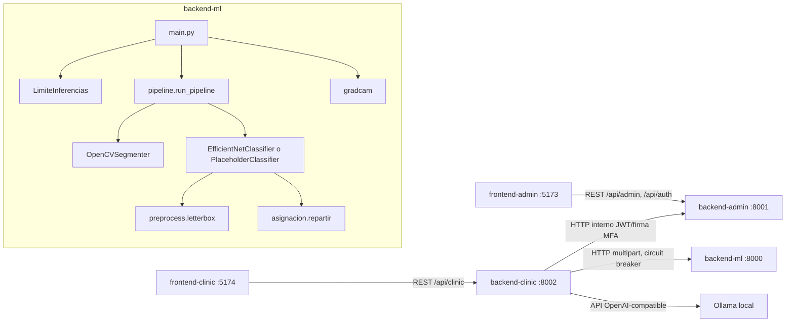
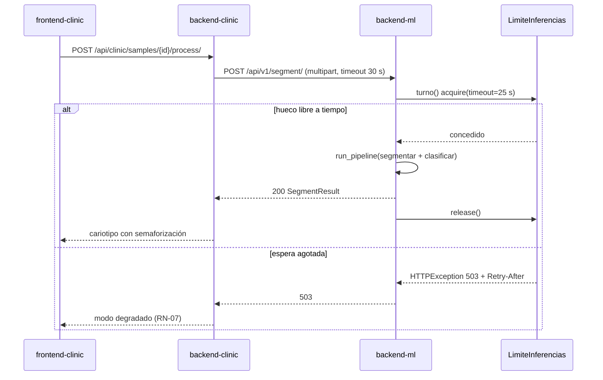

# Arquitectura — karyoumss-main

## Architecture Analysis

### System Overview

Monorepo con cinco servicios desplegables por separado en desarrollo local, sin Docker Compose en el repositorio. Dos bounded contexts Django (clínico y administrativo), un microservicio de inferencia FastAPI y dos SPAs React. Un proxy Caddy de desarrollo (`Caddyfile.dev`, :3000) unifica el origen de los frontends para compartir el JWT (ADR-0020).

| Servicio | Puerto | Stack |
|---|---|---|
| backend-ml | 8000 | FastAPI + uvicorn, OpenCV, PyTorch (CPU) |
| backend-admin | 8001 | Django 5 + DRF (autoridad JWT) |
| backend-clinic | 8002 | Django 5 + DRF |
| frontend-admin | 5173 | React 18 + Vite 5 |
| frontend-clinic | 5174 | React 18 + Vite 5 + Konva |

### Architectural Style

**Microservicios por bounded context (híbrido)**. Evidencias: puertos y `requirements.txt` independientes; backend-clinic habla con backend-ml y backend-admin solo por HTTP (`pipeline_client.py`, `admin_client.py`), y su `settings.py` declara "cero acoplamiento con backend-admin". Dentro de backend-ml la arquitectura es **hexagonal** (ADR-0007): `ports.py` define `SegmenterPort` y `ClassifierPort`, y los adaptadores (`OpenCVSegmenter`, `EfficientNetClassifier`, `PlaceholderClassifier`) se intercambian sin tocar la API.

### Component Relationships



Texto alternativo: los frontends hablan cada uno con su backend. backend-clinic llama a backend-admin (autenticación y firma), a backend-ml (inferencia, con circuit breaker) y a Ollama (narrativa). Dentro de backend-ml, `main.py` pasa por `LimiteInferencias` antes de invocar el pipeline (segmentador + clasificador) o Grad-CAM. El clasificador usa el preprocesado letterbox y, opcionalmente, el reparto global.

### Data Flow

Imagen de metafase (bytes BMP/PNG/JPG/TIFF) → `load_gray` → `segment` (Otsu + watershed) → `Detection[]` (bbox, área, centroide) → `classify_all` (letterbox contra `ref_h` = altura mediana, softmax, argmax o reparto ADR-0033) → `SegmentResult` (JSON). backend-clinic lo ingiere como `Karyotype`/`Chromosome`. backend-ml no tiene estado persistente: el único estado de proceso es el singleton del clasificador y el semáforo de `LimiteInferencias`.

### Key Design Decisions

- **ADR-0007**: microservicio de inferencia hexagonal; el modelo se intercambia por adaptador.
- **DD-AUD-001 F1**: los endpoints de inferencia son `def` (threadpool), no `async def`. Un `BoundedSemaphore` (`ML_MAX_INFERENCIAS`=1) limita la concurrencia y, si la espera supera `ML_ESPERA_MAX_S`=25 s, responde 503 + `Retry-After` (contrapresión, por debajo de los 30 s del cliente). La carga del modelo va protegida con un lock de doble comprobación.
- **RN-07**: sin torch o sin modelo, el sistema cae al `PlaceholderClassifier`; backend-clinic trata los errores HTTP y el circuito abierto como modo degradado.
- **ADR-0033**: reparto global con cupos blandos, apagado por defecto (`ML_ASIGNACION_ENABLED`).
- `/health/` no pasa por el semáforo: debe responder durante una inferencia.

### Improvement Opportunities

- `LimiteInferencias` no expone su ocupación; es lo que resuelve el intent activo.
- `pipeline_client.trigger_processing/get_status` apuntan a rutas que backend-ml no expone (ver `code-quality-assessment.md`).
- Faltan orquestación de contenedores y CI (aplazados por DD-AUD-001 a S05–S07).
- `/xai/` y `/classify/` no declaran `response_model`.

## Interaction Diagrams

### Segmentación de una muestra (transacción clínica principal)



Texto alternativo: el frontend pide procesar la muestra y backend-clinic envía la imagen a `/api/v1/segment/`. backend-ml pide un turno al límite. Si lo obtiene, ejecuta el pipeline, responde 200 y libera el turno. Si la espera se agota, responde 503 con `Retry-After` y backend-clinic degrada a modo manual.

### Consulta de estado sin semáforo (`/health/` hoy; el endpoint de estado del intent seguirá el mismo camino)

```mermaid
sequenceDiagram
    participant C as Cliente
    participant ML as backend-ml (event loop)
    participant L as LimiteInferencias
    C->>ML: GET /health/
    Note over ML,L: no llama a turno(); responde aunque haya inferencias en curso
    ML-->>C: 200 HealthOut
```

Texto alternativo: `/health/` se atiende sin pedir turno al límite, por lo que responde aunque el semáforo esté ocupado. El endpoint de estado del intent debe leer los contadores de `LimiteInferencias` por el mismo camino, sin adquirirlo.
