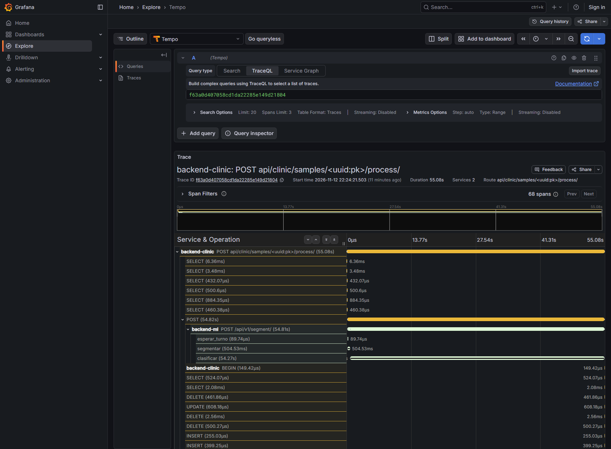
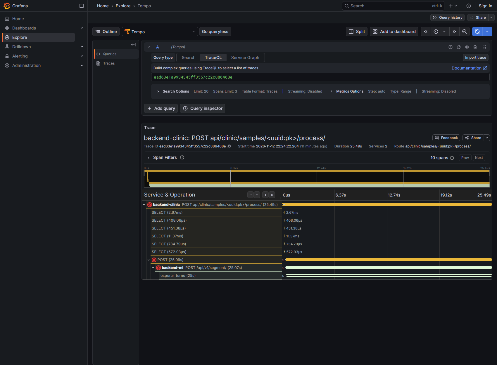

# Informe — p95 con k6 y una traza de OpenTelemetry (DD-OBS-001 T5)

| Campo | Valor |
|---|---|
| **Fecha** | 2026-11-12 |
| **Diseño** | [DD-OBS-001](../../docs/design/DD-OBS-001.md) |
| **Máquina** | Windows 10, 2 núcleos físicos, Docker Desktop 29.1.3. Todo en el mismo host |
| **Stack** | `compose.yaml` con los perfiles `obs` y `carga`; `ML_MAX_INFERENCIAS=1`, `ML_ESPERA_MAX_S=25` |

## Cómo se repite

    BIOMED_TRAZAS=http://tempo:4318 docker compose --profile obs up -d --wait
    docker compose --profile carga run --rm carga-semilla
    docker compose --profile carga run --rm k6 run /k6/carga.js

En Git Bash hay que anteponer `MSYS_NO_PATHCONV=1` a la tercera orden. La traza se
abre en Grafana (http://localhost:3000) → Explore → Tempo → TraceQL:

    { resource.service.name = "backend-clinic" && name =~ "POST.*process.*" }

## 1. El p95

Una corrida de 120 s con las trazas encendidas: 5 lecturas por segundo y, cada
60 s, dos «procesar» a la vez. Datos en
[`resultados/carga-con-trazas.json`](resultados/carga-con-trazas.json).

| Petición | Peticiones | p50 | **p95** | Máximo | Errores |
|---|---|---|---|---|---|
| Lectura · `GET /samples/{id}/karyotype/` | 601 | 96 ms | **431 ms** | 778 ms | 0 % |
| Procesar · `POST /samples/{id}/process/` | 4 | 36,4 s | **53,8 s** | 55,1 s | **50 %** |

Con solo 4 peticiones, el p95 de «procesar» es casi el máximo. Lo que importa de
esa fila es el 50 % de errores, y la traza lo explica.

## 2. La traza lenta

### La que termina bien: 55,08 s

Traza `f63a0d407058cd1da22285e149d21804`.

| Tramo | Servicio | Empieza | Dura | % del total |
|---|---|---|---|---|
| `POST …/process/` | backend-clinic | 0 ms | 55.075 ms | 100 % |
| ↳ `POST` (la llamada a backend-ml) | backend-clinic | +176 ms | 54.819 ms | 99,5 % |
| &nbsp;&nbsp;↳ `POST /api/v1/segment/` | backend-ml | +187 ms | 54.807 ms | 99,5 % |
| &nbsp;&nbsp;&nbsp;&nbsp;↳ `esperar_turno` | backend-ml | +220 ms | 0 ms | 0 % |
| &nbsp;&nbsp;&nbsp;&nbsp;↳ `segmentar` (46 cromosomas) | backend-ml | +220 ms | 505 ms | 0,9 % |
| &nbsp;&nbsp;&nbsp;&nbsp;↳ **`clasificar`** (46 cromosomas) | backend-ml | +725 ms | **54.266 ms** | **98,5 %** |
| 62 consultas SQL (leer la muestra y guardar el cariotipo) | backend-clinic | — | 33 ms en total | 0,06 % |

**En qué tramo se va el tiempo: en `clasificar`.** Es el 98,5 % de la petición.

**Por qué:**
- **Es CPU pura.** `clasificar` pasa los 46 recortes por EfficientNet-B3 (300 px) en
  CPU, sin GPU.
- **Las lecturas de k6 la alargan poco.** Repetida sin k6 (§3, comprobación en
  vivo), la misma inferencia tardó 47,8 s. Con las 5 lecturas por segundo
  alrededor tardó 46 y 54 s. La carga de lectura no es la causa principal.
- **Una diferencia sin explicar.** DD-OPS-001 anotó «~19 s» para una metafase real
  de 38 cromosomas. Aquí son 46 recortes y 46–54 s. No se investigó de dónde sale
  la diferencia (número de recortes, Tempo y Grafana en la misma máquina, o la
  propia instrumentación); queda como pregunta abierta.
- **Lo demás no pesa.** La red entre servicios cuesta unos 11 ms (de +176 a +187),
  segmentar medio segundo y la base 33 ms.

### La que falla: 25,49 s y un 503

Traza `ead63e1a9934345ff3557c22c886468e`.

| Tramo | Servicio | Dura | Dato |
|---|---|---|---|
| `POST …/process/` | backend-clinic | 25.487 ms | 503 |
| ↳ `POST /api/v1/segment/` | backend-ml | 25.067 ms | 503 |
| &nbsp;&nbsp;↳ **`esperar_turno`** | backend-ml | **24.998 ms** | `turno_conseguido = false` |

No hay tramo `segmentar` ni `clasificar`: esta petición **nunca llegó a
ejecutarse**. Pasó 25 s esperando turno, que es exactamente `ML_ESPERA_MAX_S`, y
`backend-ml` la rechazó. `backend-clinic` lo tradujo a `503 ML_DEGRADED`.

Esto explica el 50 % de errores: en cada pareja, una petición entra y la otra
espera 25 s y falla. Las dos parejas de la corrida dieron lo mismo.

## 3. Las hipótesis

Se fijaron en DD-OBS-001 D7, antes de medir.

| | Hipótesis | Resultado |
|---|---|---|
| **H1** | Más del 80 % del tiempo de «procesar» está en `backend-ml`, y el tramo más largo es `clasificar`, no `segmentar` | **Se cumple.** 99,5 % en `backend-ml`; `clasificar` es el 98,5 % y `segmentar` el 0,9 %. En la otra traza con 200: 45.931 ms de 46.571 (98,6 %) |
| **H2** | Con dos «procesar» a la vez, el segundo pasa en `esperar_turno` casi lo mismo que tarda la inferencia del primero | **No se cumple.** El segundo espera 25 s, no 46–54 s: la espera tiene un tope y, al alcanzarlo, la petición falla |

### El hallazgo que deja H2

El tope de espera (25 s) es **menor** que la duración de una inferencia bajo carga
(46–54 s). Consecuencia: en esta máquina, si dos analistas procesan a la vez, **el
segundo siempre recibe `ML_DEGRADED`**, aunque el motor esté sano y trabajando.

Antes de las trazas eso se veía como «a veces el pipeline de IA no está
disponible». Con la traza se ve que el motor sí está disponible y lo que falla es
la espera.

**Comprobación en vivo**, sin k6: dos «procesar» a la vez y, mientras tanto, el
endpoint nuevo `GET /api/clinic/pipeline/inferencias/`.

| Momento | `en_curso` | `libres` | `en_espera` | `ocupado` |
|---|---|---|---|---|
| En reposo | 0 | 1 | 0 | no |
| A los 5 s | 1 | 0 | 1 | sí |
| A los 15 s | 1 | 0 | 1 | sí |
| Al terminar | 0 | 1 | 0 | no |

El primero terminó con 200 en 47,8 s; el segundo, con 503 a los 27,5 s.

No se cambia el tope en este trabajo. Las salidas posibles van aparte, porque cada
una cambia el comportamiento que ve el analista:
- **Subir `ML_ESPERA_MAX_S`** por encima de la inferencia más larga medida. Es lo
  más simple, pero el segundo analista esperaría casi dos minutos sin saber por
  qué.
- **Decir «ocupado» y no «degradado».** El 503 por turno agotado es distinto de un
  motor caído; el visor podría mostrar «el motor está procesando otro caso» con
  el `Retry-After` que ya viene en la respuesta. **Hecha el 13/11** (DD-OBS-001
  §10): `503 ML_BUSY`, y ese rechazo dejó de contar para el circuit breaker. Los
  números de este informe son anteriores a ese cambio.
- **Procesar en segundo plano**, con una cola, que es lo que ya prevé ADR-0031.

## 4. Lo que cuestan las trazas

Riesgo anotado en DD-OBS-001 §4. Solo lecturas (5 por segundo, 60 s), tres corridas
con trazas y tres sin ellas, sin ninguna inferencia en curso. Datos en
`resultados/lectura-*.json`.

| | p50 (3 corridas) | p95 (3 corridas) |
|---|---|---|
| Con trazas | 54 · 52 · 49 ms | 254 · 156 · 125 ms |
| Sin trazas | 46 · 44 · 46 ms | 119 · 123 · 148 ms |

- **p50:** sube unos 6 ms (de ~46 a ~52 ms, un 13 %), en las tres corridas.
- **p95:** los rangos se solapan (125–254 frente a 119–148 ms). Con tres corridas
  no se puede afirmar una diferencia. La primera corrida con trazas (254 ms) fue
  la primera tras reiniciar los servicios.

El diseño decía quitar la instrumentación de `sqlite3` si el p95 subía más de un
10 %. Con estos datos no se puede decir que suba ni que no. Se deja como está,
por dos razones: las trazas están **apagadas por omisión**, así que este coste solo
se paga cuando alguien las enciende para diagnosticar; y los tramos de SQL son los
que permiten afirmar que la base no es el problema (33 ms de 55 s).

## 5. Amenazas a la validez

- **Una sola corrida de 120 s para el p95,** con 4 «procesar». Alcanza para explicar
  una traza, no para dar un p95 estable de «procesar».
- **Todo en una máquina de 2 núcleos:** k6, los tres servicios, Tempo y Grafana
  compiten por la CPU. Los tiempos absolutos no valen para otra máquina; las
  proporciones entre tramos, sí.
- **El tiempo de una inferencia varía mucho en esta máquina.** La misma petición,
  sola y sin k6, tardó 47,8 s a las 22:30 y 90 s y 105 s una hora después, tras
  reconstruir las imágenes. No se encontró la causa: los contenedores estaban en
  reposo y la CPU es un i5-3317U de bajo consumo (2 núcleos, 1,7 GHz), que llevaba
  horas al 100 %. Por eso lo que este informe afirma son las **proporciones**
  (`clasificar` frente a lo demás), que se mantuvieron, y no los segundos.
  A 105 s, la inferencia queda cerca del plazo de `backend-clinic` (120 s).
- **Metafases sintéticas:** 46 manchas separadas. Una metafase real tiene
  cromosomas que se tocan, y `segmentar` podría tardar más. `clasificar` depende
  del número de recortes, que es el mismo.
- **El p95 de lectura (431 ms) se midió con inferencias en curso.** Sin ellas, y con
  trazas, fue de 125 a 254 ms (§4). Es decir, la inferencia sí encarece las
  lecturas, aunque las lecturas apenas alarguen la inferencia.
- **El coste de las trazas (§4)** se midió con tres corridas por lado y sin
  alternar el orden: las tres con trazas fueron primero.

## 6. Un fallo del instrumento, cazado antes de medir

La primera corrida de k6 dio **400 en todas las peticiones**. No era el sistema:
k6 llama a `http://web:8080` desde la red de Docker, y Django rechazaba el nombre
de host `web` (`DJANGO_ALLOWED_HOSTS`). Desde un navegador, que usa `localhost`,
no se veía. Se añadió `web` a los hosts permitidos del stack. El guion de k6
comprueba una petición antes de medir y se detiene si falla, y por eso no llegó a
dar números falsos.
