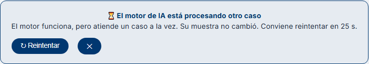

# Demo 4 (release 8.4.0) — Grupo BIOMED UMSS

| Campo | Valor |
|---|---|
| **Demo** | 4 · última del Módulo 8. Modalidad: **video** (plazo: lunes 16 de noviembre de 2026, 23:59) |
| **Release** | `release/8.4.0` |
| **Repositorio** | https://github.com/guillemc92/karyoumss |
| **Integrantes** | 1 (grupo individual) |
| **Canal oficial** | Classroom (este archivo es la copia del repositorio) |

## Integrantes y funcionalidades

Una funcionalidad mediana y tres pequeñas. Las cuatro funcionan sobre el stack de
producción de la release (`compose.yaml`).

El alcance sigue lo pedido en clase para esta demo: la base de siempre y una
pequeña más. La cuarta se añadió el 13/11 y sale de lo que midió la primera.

| Integrante | Funcionalidad | Tamaño | Caso de uso (FSD) | Diseño |
|---|---|---|---|---|
| Guillermo Mamani Chambi ([`guillemc92`](https://github.com/guillemc92)) | 1 · Trazas distribuidas y prueba de carga | Mediana | FSD-UC-002 (segmentación y clasificación) y FSD-UC-007 (modo degradado); NFR-001 y NFR-004 | [DD-OBS-001](../design/DD-OBS-001.md) |
| Guillermo Mamani Chambi | 2 · Ocupación del motor de IA | Pequeña | FSD-UC-007 (modo degradado) | Práctica AI-DLC (rama `feature-con-aidlc`) y DD-OBS-001 §9 |
| Guillermo Mamani Chambi | 3 · El analista llega a su lista de muestras al entrar | Pequeña | FSD-UC-002, precondición: el analista autenticado abre sus casos ([ADR-0017](../adr/0017-sistema-autenticacion-login.md) D7) | Corrección de un fallo visto en la Demo 3 |
| Guillermo Mamani Chambi | 4 · El visor dice «motor ocupado», no «pipeline no disponible» | Pequeña | FSD-UC-007 (modo degradado): distinguir el motor caído del motor ocupado | [DD-OBS-001](../design/DD-OBS-001.md) §10 (D8) |

## Funcionalidad 1 — Trazas distribuidas y prueba de carga

**Qué resuelve.** Procesar una metafase cruza tres procesos (`web` →
`backend-clinic` → `backend-ml`) y solo se conocía su duración total. Ahora cada
petición deja una traza que dice en qué tramo se fue el tiempo.

**Criterios de aceptación** (verificados el 12/11; detalle en DD-OBS-001 §9):

1. **El stack levanta con y sin trazas.** Con
   `BIOMED_TRAZAS=http://tempo:4318 docker compose --profile obs up -d --wait`
   arrancan además Tempo y Grafana, todo `healthy` en 77 s. Sin el perfil, el stack
   es el de la release 8.3.0.
2. **Una sola traza cruza los servicios.** Un `POST …/process/` deja 68 tramos con
   el mismo `trace_id`: los de `backend-clinic` (la petición, sus 62 consultas SQL y
   la llamada saliente) y los de `backend-ml`.
3. **Un tramo por etapa de la inferencia:** `esperar_turno`, `segmentar` y
   `clasificar`, cada uno con su duración.
4. **Apagadas por omisión.** Sin la variable no se crea nada: las suites pasan sin
   cambios (backend-clinic, 1.217 pruebas y 91,60 %).
5. **Sin datos del paciente (RN-03).** No se guardan cabeceras, cuerpos ni
   parámetros de SQL, y la URL se guarda sin su texto de búsqueda. Hay pruebas que
   lo fijan, y la prueba de humo lo comprueba contra Tempo.
6. **p95 con k6 y la traza en Grafana.** Ver «La pregunta fija».
7. **En el CI.** `imagenes-stack.yml` levanta el stack con el perfil `obs` y corre
   `deploy/humo-trazas.sh`.

**Evidencia:** [`bench/demo4/INFORME.md`](../../bench/demo4/INFORME.md), con las
capturas de Grafana.

## Funcionalidad 2 — Ocupación del motor de IA

**Qué resuelve.** El motor atiende una inferencia por vez. Nadie podía ver si
estaba libre, ocupado o con cola.

**Criterios de aceptación:**

1. **`GET /api/v1/inferencias/` en `backend-ml`** devuelve `maximo`, `en_curso`,
   `libres`, `espera_max_s` y `en_espera`. No pasa por el semáforo: responde aunque
   no quede ningún hueco.
2. **Solo entre servicios.** Exige el secreto interno: 403 si falta o no coincide,
   503 si `backend-ml` no lo tiene configurado. En el stack lo recibe por archivo,
   en su propia carpeta de secretos.
3. **`GET /api/clinic/pipeline/inferencias/` en `backend-clinic`** lo expone al
   analista autenticado, con un campo más, `ocupado`. Si el motor no responde,
   `503 ML_DEGRADED`.
4. **Consultar el estado no abre el circuit breaker.** Mirar la ocupación no puede
   dejar al visor en modo manual.
5. **En el contrato.** Los dos endpoints están en su `openapi.json`, generado desde
   el código, con el control de deriva del CI.
6. **Comprobado en vivo:** con dos «procesar» a la vez responde
   `en_curso: 1, libres: 0, en_espera: 1, ocupado: true`, y vuelve a `libres: 1` al
   terminar (INFORME §3).

**Lo que queda fuera:** el endpoint no tiene pantalla propia. Lo que el analista
ve de la ocupación es el aviso de la funcionalidad 4.

## Funcionalidad 3 — El analista llega a su lista de muestras al entrar

**Qué resuelve.** En la Demo 3, al entrar como analista por el stack, el navegador
iba a `/clinic//clinic/samples` y mostraba una página en blanco.

**Criterios de aceptación:**

1. **La dirección es correcta con las dos formas de la base:** el origen de la app
   (`http://localhost:5174`, en desarrollo) y su ruta detrás del proxy (`/clinic/`,
   en el stack). Siempre termina en `/clinic/samples`, sin repetir `/clinic` ni
   dejar una barra doble.
2. **La prueba ya no deja pasar el fallo.** La anterior comprobaba que la dirección
   «contuviera» `/clinic/samples`, y la rota también lo contiene. Ahora exige el
   final exacto, con siete casos de base.
3. **Los guiones de shell van con LF.** Con `.gitattributes`, un clon hecho en
   Windows ya no los convierte a CRLF. Ese era el segundo fallo de la Demo 3:
   Postgres no ejecutaba su guion de inicio.

## Funcionalidad 4 — El visor dice «motor ocupado», no «pipeline no disponible»

**Qué resuelve.** La traza de la funcionalidad 1 mostró que el segundo analista
recibía «Pipeline de IA no disponible» con el motor sano: solo estaba ocupado.
Además, cada uno de esos rechazos contaba para el circuit breaker, y unos pocos
seguidos dejaban a todos en modo manual.

**Criterios de aceptación** (DD-OBS-001 §10):

1. **`POST /api/clinic/samples/{id}/process/` responde `503 ML_BUSY`** cuando el
   motor no tiene turno, con `retry_after_seconds` y la cabecera `Retry-After`.
   `ML_DEGRADED` queda para el motor caído.
2. **«Ocupado» no abre el circuit breaker.** Cinco seguidos, con el umbral en 2, y
   el circuito sigue cerrado. Una caída de verdad lo sigue abriendo.
3. **La muestra no cambia** tras un `ML_BUSY`.
4. **El visor muestra un aviso con la cuenta atrás** y un botón para reintentar.
   No muestra el banner de modo degradado ni ofrece el modo manual.
5. **En el contrato.** `process` estaba sin describir; ahora tiene sus respuestas,
   con los dos códigos del 503.

**Comprobado sobre el stack** (imágenes 8.4.0 reconstruidas, dos «procesar» a la
vez con muestras sintéticas):

| Petición | Respuesta | Tiempo |
|---|---|---|
| La primera | `200`, 46 cromosomas | 42,5 s |
| La segunda | `503 ML_BUSY`, `retry_after_seconds: 25`, cabecera `Retry-After: 25` | 25,2 s |
| Una tercera, ya con el motor libre | `200`: el circuito no se abrió | 36,3 s |

Mientras tanto, `GET /api/clinic/pipeline/inferencias/` respondía
`en_curso: 1, libres: 0, en_espera: 1, ocupado: true`.

En Chromium, con dos pestañas: la segunda muestra el aviso, sin el banner de
modo degradado; la cuenta baja de 25 a 22 s en tres segundos; y «Reintentar», con
el motor ya libre, procesa y quita el aviso.

**Lo que queda fuera:** no acorta la inferencia. El segundo analista sigue
esperando a que termine el primero; ahora sabe por qué y cuánto. Procesar en
segundo plano con una cola es lo que prevé ADR-0031.

## El contrato

Los endpoints que se presentan están en el `openapi.json` de su servicio, generado
desde el código:

| Endpoint | Contrato | Cómo se genera |
|---|---|---|
| `GET /api/v1/inferencias/` | `backend-ml/openapi.json` | `python -m app.exportar_openapi` |
| `GET /api/clinic/pipeline/inferencias/` | `backend-clinic/openapi.json` | `python manage.py spectacular --file openapi.json --validate` |
| `POST /api/clinic/samples/{id}/process/` | `backend-clinic/openapi.json` | Ídem |

El workflow `contrato-openapi.yml` falla si el archivo del repositorio no es
exactamente el que genera el código. Una prueba local hace el mismo control antes
del PR.

## La pregunta fija: «Muestra tu p95 con k6 y explica una traza de OpenTelemetry»

**El p95** (120 s, 5 lecturas por segundo y dos «procesar» a la vez cada 60 s):

| Petición | Peticiones | p50 | **p95** | Errores |
|---|---|---|---|---|
| Lectura · `GET /samples/{id}/karyotype/` | 601 | 96 ms | **431 ms** | 0 % |
| Procesar · `POST /samples/{id}/process/` | 4 | 36,4 s | **53,8 s** | 50 % |

**La traza lenta** (55,08 s), en Grafana → Explore → Tempo:

| Tramo | Dura | % |
|---|---|---|
| `POST …/process/` en backend-clinic | 55.075 ms | 100 % |
| ↳ llamada a backend-ml | 54.819 ms | 99,5 % |
| &nbsp;&nbsp;↳ `segmentar` | 505 ms | 0,9 % |
| &nbsp;&nbsp;↳ **`clasificar`** | **54.266 ms** | **98,5 %** |
| 62 consultas SQL | 33 ms | 0,06 % |

**En qué tramo se va el tiempo y por qué.** En `clasificar`: pasa los 46 recortes
por EfficientNet-B3 en CPU, sin GPU. La red entre servicios cuesta 11 ms y la base
33 ms.

**Y el 50 % de errores.** La otra traza dura 25 s y solo tiene `esperar_turno`, con
`turno_conseguido = false`: esa petición nunca se ejecutó. Esperó el máximo
(`ML_ESPERA_MAX_S`, 25 s) mientras el motor clasificaba la primera, que tarda de 46
a 54 s. El motor no estaba caído: estaba ocupado.

**Lo que se hizo con eso.** La funcionalidad 4: ese rechazo ya no se presenta como
una caída ni suma al circuit breaker. No lo evita: para eso hace falta la cola.

**Lo que dice el FSD.** FSD-UC-002 (excepción A2) pone el umbral de timeout del
modelo en 30 s, y NFR-001 pide menos de 15 s por imagen **con GPU**. En esta
máquina, sin GPU, la inferencia tarda de 46 a 54 s. La traza convierte ese
incumplimiento en un dato: dónde está y cuánto es.

## Guion del video (≈ 9 min)

### Antes de grabar

1. Construir y levantar. La primera construcción tarda unos 50 min en esta máquina:

       git clone --branch release/8.4.0 https://github.com/guillemc92/karyoumss C:\demo4\karyoumss
       cd C:\demo4\karyoumss
       $env:BIOMED_TRAZAS = "http://tempo:4318"
       docker compose --profile obs --profile carga build
       docker compose --profile obs up -d --wait
       docker compose --profile carga run --rm carga-semilla

2. Cerrar lo que compita por la CPU. Abrir Grafana en http://localhost:3000.

### En el video

| Min | Qué se muestra | Qué se dice |
|---|---|---|
| 0:00 | `docs/demos/demo-4.md`, la tabla de funcionalidades | Las tres funcionalidades, su tamaño y su caso de uso del FSD |
| 0:45 | `docker compose ps`: Tempo y Grafana `healthy` | F1, criterio 1: el mismo stack, con un perfil más |
| 1:15 | Entrar por http://localhost:8080 como `analista@biomed.local`. Queda en `/clinic/samples` | F3: en la Demo 3 esto era una página en blanco. Enseñar la prueba con los siete casos |
| 2:15 | `docker compose --profile carga run --rm k6 run /k6/carga.js`, y mientras corre, `GET /api/clinic/pipeline/inferencias/` | F2: `en_curso: 1, en_espera: 1, ocupado: true` |
| 3:30 | El resumen de k6 | La pregunta fija: p95 de lectura y de procesar, y el 50 % de errores |
| 4:15 | Grafana → Explore → Tempo → la consulta TraceQL; abrir la traza de ~50 s | `clasificar` es el 98,5 %; segmentar, la red y la base no pesan. Por qué: EfficientNet en CPU |
| 5:45 | Abrir la traza de 25 s con 503 | Solo `esperar_turno`: nunca se ejecutó. El motor estaba ocupado, no caído |
| 6:10 | En el visor, dos pestañas con dos muestras sintéticas: «Procesar» en las dos | F4: la segunda dice «El motor de IA está procesando otro caso», con la cuenta atrás. Antes decía «Pipeline no disponible» |
| 7:00 | `backend-ml/openapi.json` y `backend-clinic/openapi.json`, y el run del CI | El contrato, generado desde el código y con control de deriva |
| 7:45 | `bench/demo4/INFORME.md`: hipótesis y amenazas a la validez | H1 se cumple, H2 no. Lo que no se midió |

## Preguntas probables

- **¿Por qué sin Collector de OpenTelemetry?** Son dos servicios y un destino. El
  Collector hace falta con más destinos o con muestreo; se declara en DD-OBS-001 D1.
- **¿Las trazas guardan datos de pacientes?** No. La ruta lleva el id interno de la
  muestra; no se guardan cabeceras, cuerpos ni parámetros de SQL, y la URL va sin su
  texto de búsqueda. Lo destapó una prueba: la instrumentación de Django guarda la
  URL completa por omisión.
- **¿Cuánto cuestan?** Unos 6 ms en el p50 de lectura. En el p95 no se puede afirmar
  una diferencia con tres corridas. Están apagadas por omisión.
- **¿Qué harías con el 50 % de errores?** No subir el límite a ciegas. De las tres
  opciones del INFORME §3 se hizo la segunda (funcionalidad 4): decir «ocupado» en
  vez de «degradado». La de fondo es procesar en segundo plano con una cola
  (ADR-0031).
- **Un «procesar» de 55 s es demasiado.** Sí. La traza dice dónde está (clasificar
  en CPU) y el visor ya no lo confunde con una caída, pero el tiempo no bajó. Las
  salidas son GPU (NFR-001 la supone) o la cola, para no tener al analista
  esperando una respuesta HTTP.
- **¿Es representativo el p95 de procesar?** No: son 4 peticiones. Sirve para
  explicar una traza, no como cifra estable. Está entre las amenazas a la validez.
